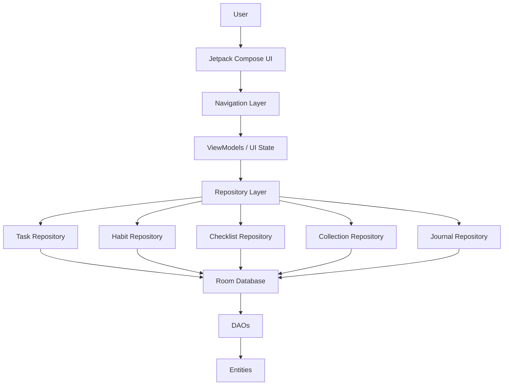
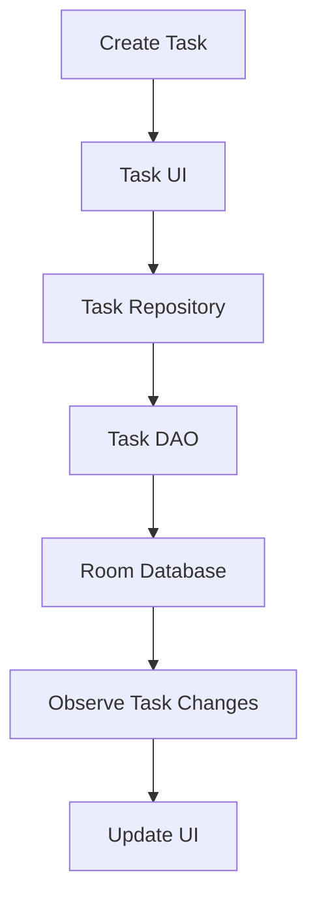
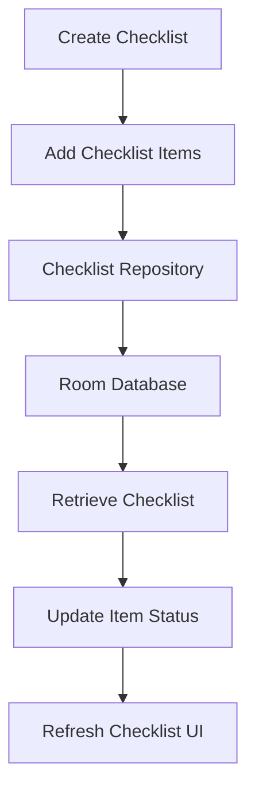
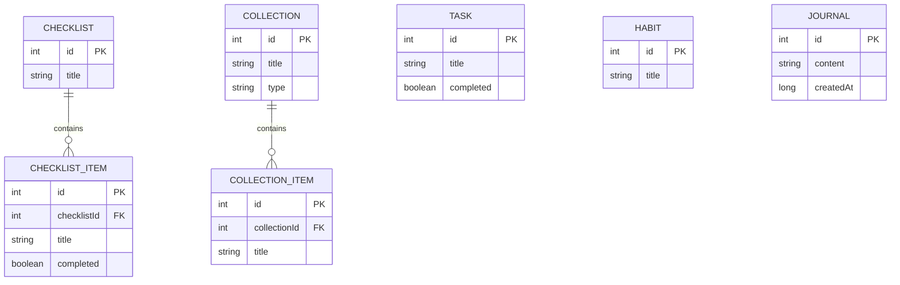

# 📋 LifeBoard (reconstructed recovery build)

**One place to organize your life, your goals, and your everyday progress.**

LifeBoard is a personal productivity application designed to bring different aspects of everyday organization into one unified workspace.

Instead of switching between multiple applications, LifeBoard brings tasks, habits, checklists, collections, and journaling together in a single environment.

The core idea is to create a centralized personal dashboard where users can organize their responsibilities, track progress, and maintain their personal records.

## ✨ Features

- ✅ **Task Management** – Organize and manage everyday tasks.
- 🔁 **Habit Tracking** – Keep track of recurring habits.
- 📝 **Checklists** – Create and manage custom checklists.
- 🎯 **Collections** – Maintain wishlists and bucket lists.
- 📔 **Journal** – Record personal thoughts and daily experiences.
- 📊 **Dashboard** – Access important productivity information from one place.
- 🗄️ **Centralized Storage** – Keep application data organized through a shared database.

## 🏗️ Architecture

LifeBoard follows a layered architecture with clear separation between the presentation, data, and business logic layers.

The application uses the Repository Pattern to separate UI components from database operations.

### High-Level Architecture



### Architecture Layers

**1. Presentation Layer**

Responsible for displaying application screens and handling user interactions.

- Jetpack Compose screens.
- Navigation.
- UI state management.
- Dashboard components.

**2. Repository Layer**

Acts as an intermediary between the presentation layer and the database.

- HabitRepository
- TaskRepository
- ChecklistRepository
- CollectionRepository
- JournalRepository

**3. Data Layer**

Responsible for persistent application storage.

- Room Database.
- Data Access Objects (DAOs).
- Entity models.

## ⚙️ Core Application Logic

LifeBoard is built around independent productivity modules that share a centralized database.

### 1. Task Management



Tasks are created and managed through the repository layer. Database changes can be observed by the UI to keep displayed information synchronized.

### 2. Habit Tracking

The habit module manages recurring activities and their progress.

- Create habits.
- Track completion.
- Maintain habit records.
- Display progress.

### 3. Checklist Management



Checklists and their individual items are managed through separate data models, allowing each checklist to contain multiple items.

### 4. Collections

Collections provide a structured way to organize personal goals, wishlists, and bucket lists.

- Create collections.
- Add collection items.
- Update item information.
- Manage collection progress.

### 5. Journal

The journal module provides a place to create and maintain personal entries.

- Write journal entries.
- Save entries locally.
- Retrieve previously saved entries.
- Manage personal records.

## 🗄️ Database Design

LifeBoard uses Room as its local persistence layer.

### Main Entities

| Entity | Purpose |
|---|---|
| TaskEntity | Stores task information |
| HabitEntity | Stores habit information |
| ChecklistEntity | Stores checklist details |
| ChecklistItemEntity | Stores individual checklist items |
| CollectionEntity | Stores collection information |
| CollectionItemEntity | Stores collection items |
| JournalEntity | Stores journal entries |

### Database Relationship Overview



*Conceptual schema; actual entity fields and relationships should match the Room implementation.*

## 📂 Project Structure

```text
LifeBoard/
├── app/
│   └── src/
│       └── main/
│           ├── java/com/example/lifeboardapp/
│           │   ├── data/
│           │   │   ├── database/
│           │   │   ├── dao/
│           │   │   ├── entity/
│           │   │   └── repository/
│           │   │
│           │   ├── ui/
│           │   │   ├── dashboard/
│           │   │   ├── tasks/
│           │   │   ├── habits/
│           │   │   ├── checklist/
│           │   │   ├── collections/
│           │   │   └── journal/
│           │   │
│           │   ├── navigation/
│           │   ├── viewmodel/
│           │   ├── LifeBoardApp.kt
│           │   └── AppContainer.kt
│           │
│           ├── res/
│           └── AndroidManifest.xml
│
├── build.gradle.kts
├── settings.gradle.kts
└── README.md
```

## 🛠️ Technology Stack

- **Language:** Kotlin
- **UI:** Jetpack Compose
- **Architecture:** Layered Architecture
- **Database:** Room
- **Navigation:** Navigation Compose
- **Asynchronous Operations:** Kotlin Coroutines and Flow
- **IDE:** Android Studio

## 🚀 Getting Started

### Prerequisites

- Android Studio.
- Android SDK.
- JDK compatible with the project Gradle configuration.
- Git.

### Installation

1. Clone the repository.

```bash
git clone YOUR_REPOSITORY_URL
```

2. Open LifeBoard in Android Studio.
3. Synchronize Gradle dependencies.
4. Build the project.
5. Run the application on an Android device or emulator.

## 📸 Screenshots

Add screenshots of your dashboard and individual productivity modules.

```markdown


```

## 🔮 Future Improvements

- Calendar integration.
- Advanced productivity analytics.
- Home screen widgets.
- Data backup and restore.
- Cloud synchronization.
- Custom themes and personalization.
- Improved habit progress visualization.

## 🤝 Contributing

Contributions, suggestions, and feature requests are welcome.

## 📄 License

Add your chosen open-source license if applicable.
